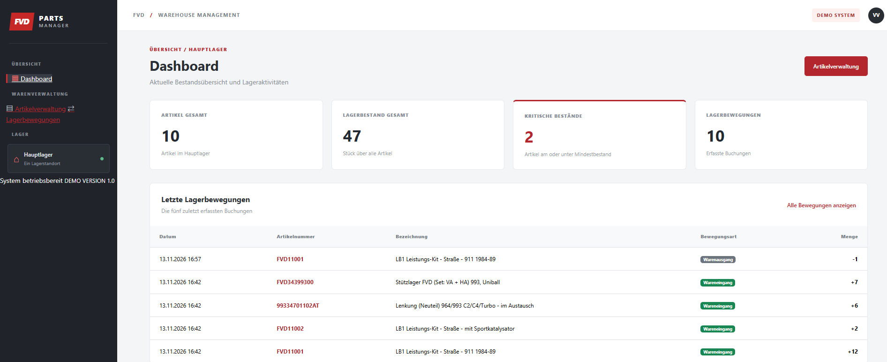
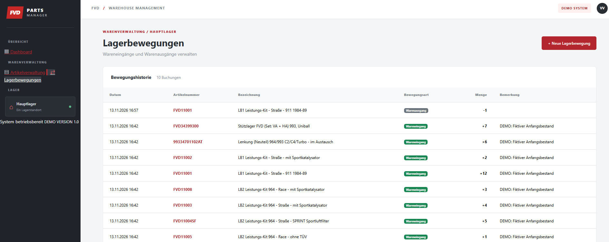

# FVD Parts Manager

**Webbasierte Lagerverwaltung für Ersatzteile – entwickelt mit ASP.NET Core 10, Blazor, Entity Framework Core und PostgreSQL 18.**

Dieses Projekt ist eine eigenständig entwickelte Demo-Anwendung zur Verwaltung von Ersatzteilen und Lagerbewegungen. Es demonstriert die Umsetzung typischer ERP-Funktionen – von der Datenmodellierung und Geschäftslogik bis zur Bereitstellung auf einem Linux-Server.

## Live-Demo

**[FVD Parts Manager online öffnen](https://fvd-partsmanager.178.105.105.251.sslip.io/)**

Die Anwendung läuft auf einem Hetzner-Server und ist über HTTPS erreichbar. Der Zugriff ist durch HTTP Basic Authentication geschützt. Die Zugangsdaten werden auf Anfrage zur Verfügung gestellt.

## Screenshots

### Dashboard



Übersicht über Lagerkennzahlen, kritische Bestände und aktuelle Lagerbewegungen.

### Artikelverwaltung


Verwaltung von Ersatzteilen mit Artikelnummer, Bezeichnung, Lagerbestand und Mindestbestand.

### Lagerbewegungen



Erfassung und Übersicht von Wareneingängen und Warenausgängen.

## Funktionen

- **Dashboard:** Aktuelle Lagerkennzahlen, Mindestbestandswarnungen und letzte Lagerbewegungen.
- **Artikelverwaltung:** Artikel anlegen, anzeigen, bearbeiten und löschen.
- **Lagerbewegungen:** Wareneingänge und Warenausgänge erfassen und dokumentieren.
- **Bestandsführung:** Automatische Aktualisierung der Lagerbestände bei Buchungen.
- **Datenintegrität:** Transaktionsbasierte Verarbeitung von Lagerbewegungen.
- **Demo-Daten:** Reproduzierbare Initialisierung mit Beispielartikeln und Lagerbewegungen.
- **Datenbankmigrationen:** Versionsverwaltung des Datenbankschemas mit EF Core Migrations.

## Technologie-Stack

| Bereich | Technologie |
|---|---|
| Backend | C#, .NET 10, ASP.NET Core |
| Benutzeroberfläche | Blazor Web App, Razor Components, Bootstrap |
| Datenzugriff | Entity Framework Core 10 |
| Datenbank | PostgreSQL 18 |
| Containerisierung | Docker, Docker Compose |
| Webserver / Reverse Proxy | Nginx |
| HTTPS | Let's Encrypt / Certbot |
| Hosting | Hetzner Cloud, Ubuntu Linux |
| Versionsverwaltung | Git / GitHub |

## Architektur

Die Anwendung ist in mehrere Schichten gegliedert:

- **Components:** Blazor-Komponenten für die Benutzeroberfläche.
- **Services:** Geschäftslogik für Artikelverwaltung und Lagerbewegungen.
- **Models:** Datenmodelle für Artikel und Lagerbewegungen.
- **Data:** Entity Framework Core DbContext, Migrationen und Demo-Daten.

Die Kommunikation mit der Datenbank erfolgt über Entity Framework Core und den PostgreSQL-Provider.

### Deployment-Architektur

```text
Browser
   |
   | HTTPS (443)
   v
Nginx + Let's Encrypt
   |
   | HTTP (localhost:8090)
   v
Docker: ASP.NET Core / Blazor
   |
   | Internes Docker-Netzwerk
   v
Docker: PostgreSQL 18
   |
   v
Persistentes Docker Volume
```

Die PostgreSQL-Datenbank ist nicht direkt über einen öffentlichen Port erreichbar.

## Lokale Entwicklung

Voraussetzungen:

- .NET SDK 10
- PostgreSQL
- Eine Entwicklungsumgebung wie Visual Studio oder Visual Studio Code

Repository klonen:

```bash
git clone https://github.com/VitaliiVarshko/FVD.PartsManager.git
cd FVD.PartsManager
```

Die lokale PostgreSQL-Verbindung über die Konfiguration oder .NET User Secrets einrichten. Zugangsdaten dürfen nicht im Repository gespeichert werden.

Anwendung starten:

```bash
dotnet restore
dotnet run --project src/FVD.PartsManager.Web
```

## Deployment mit Docker Compose

Die Datei `compose.yaml` definiert folgende Dienste:

| Dienst | Aufgabe |
|---|---|
| `db` | PostgreSQL-18-Datenbank |
| `web` | ASP.NET-Core-/Blazor-Anwendung |
| `migrate` | EF-Core-Datenbankmigrationen |
| `seed` | Initialisierung der Demo-Daten |

Vor dem Start muss die Umgebungsvariable `FVD_DB_PASSWORD` gesetzt werden, beispielsweise über eine lokale `.env`-Datei, die nicht versioniert wird.

Datenbank starten:

```bash
docker compose up -d db
```

Datenbankmigrationen anwenden:

```bash
docker compose run --rm migrate
```

Demo-Daten initialisieren:

```bash
docker compose run --rm seed
```

Webanwendung starten:

```bash
docker compose up -d web
```

Der Webdienst ist standardmäßig unter `127.0.0.1:8090` erreichbar. Für den öffentlichen Zugriff wird ein separater Reverse Proxy mit HTTPS verwendet.

## Sicherheit

- Keine Passwörter oder Zugangsschlüssel im Repository.
- Datenbankzugriff ausschließlich über das interne Docker-Netzwerk.
- Webcontainer wird ohne Root-Rechte ausgeführt.
- HTTPS-Terminierung über Nginx.
- Passwortschutz für die öffentliche Demo über Nginx.
- Persistente Docker Volumes für Datenbank und ASP.NET Core Data Protection Keys.

## Projektziel

Das Projekt wurde als praxisnahes Portfolio-Beispiel entwickelt, um Kenntnisse in der **Entwicklung datenbankgestützter Webanwendungen**, in der **ERP-Geschäftslogik** sowie im **Deployment moderner .NET-Anwendungen unter Linux** zu demonstrieren.

Es handelt sich um ein unabhängiges Demonstrationsprojekt und nicht um ein offizielles Produkt der FVD Brombacher GmbH.

## Autor

**Vitalii Varshko**

Softwareentwickler mit Schwerpunkt Backend-Entwicklung, ERP-Integration und datenbankgestützte Geschäftsanwendungen.
